<picture>
  <source media="(prefers-color-scheme: dark)" srcset="./assets/banner-dark.svg">
  <source media="(prefers-color-scheme: light)" srcset="./assets/banner-light.svg">
  
</picture>

 

  Locked-down CI runners, HPC nodes, sandboxes, and networks where the only way out is HTTPS. 
  <b>PodUtils</b> is a family of small Rust tools that still work there, one static binary at a time.

 

### &nbsp;Tools

| Tool | What it does | Status |
|:--|:--|:--|
| **[podvm](https://github.com/PodUtils/podvm)** | Container runtime for rootful-but-restricted sandboxes, CI executors and HPC nodes | `beta` |
| **[podssh](https://github.com/PodUtils/podssh)** | SSH from machines whose only way out is HTTPS, through a WebSocket relay | `beta` |
| **[podnet](https://github.com/PodUtils/podnet)** | Tunnels, WARP and per-process proxying in one binary | `beta` |
| **podshell** | A resilient remote terminal, a mosh alternative for strict networks | `soon` |
| **podmesh** | Mesh networking between hosts behind NAT and strict firewalls | `soon` |
| **podcat** | Pipe bytes between sockets, tunnels and processes, like netcat and socat | `soon` |
| **podinfo** | Fetch and probe a host: what it is, and what it lets you do | `soon` |
| **podfs** | File system tools for restricted hosts and sandboxes | `soon` |

Shared libraries for all of them live in <a href="https://github.com/PodUtils/podcrates"><b>podcrates</b></a>.

 

### &nbsp;What they share

- **One static binary.** No installer, no runtime, no shared libraries. Copy it and run it.
- **No root, no daemon.** Built for hosts where you get a shell and little else.
- **Made for hostile networks.** Proxies, HTTPS-only egress and blocked UDP are the normal case, not the edge case.
- **Free to use.** Everything is under [0BSD](https://opensource.org/license/0bsd).

 

  Made with care, for the machines that make it hard.

